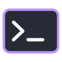

<h1 align="center">Hello world! </h1>

<strong>Software developer · Berlin · Backend &amp; systems</strong>

<a href="https://www.linkedin.com/in/tmurua/">LinkedIn</a> · <a href="https://github.com/tmurua?tab=repositories">All repositories</a>

I completed 42 School's Common Core curriculum and I'm looking for a software development role. My strongest foundations are in C and C++. Recent team projects led me to TCP networking, collaborative editing, document persistence and deployment.

## Start here

<table>
<tr>
<td width="50%" valign="top">
<h3><a href="https://github.com/tmurua/synctext">SyncText</a></h3>

A collaborative text editor with live co-editing, version history and restoration. Built by a team of five.

<strong>My work:</strong> document persistence, snapshots and restoration, deployment, health checks, database backup/restore scripts and project coordination.

TypeScript · Next.js · Yjs · PostgreSQL · Docker Compose

</td>
<td width="50%" valign="top">
<h3><a href="https://github.com/tmurua/cpp-irc-server">C++ IRC Server</a></h3>

A C++98 IRC server built with a teammate, originally called ft_irc at 42.

<strong>My work:</strong> non-blocking sockets, a poll() event loop, input/output buffering, partial sends and connection cleanup.

C++98 · TCP sockets · poll() · Unix

</td>
</tr>
</table>

These portfolio copies preserve the original team history and credits. Their READMEs explain how to run them and what I contributed.

## Languages & Tools

  
  
  
  
  

**Foundations:** C, C++, Linux/Unix, Git, Bash, TCP/IP, algorithms and data structures.

  
  
  
  

**In recent projects:** TypeScript, Next.js, Prisma, PostgreSQL, Docker Compose, NGINX and Yjs.

Before software development, I managed logistics operations in São Paulo and wrote software documentation in English, Portuguese and Spanish.
